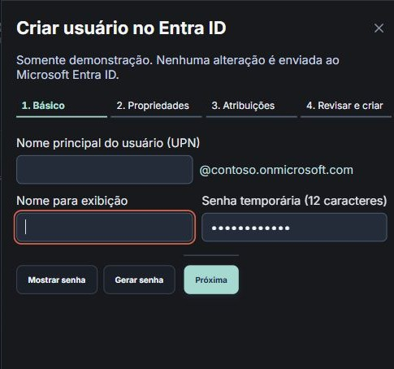

# Flextrix Identity & Access

[Leia em português](README.md)

**Portfolio project by Gabriel Grans.**

A bilingual web application for access operations. It brings Microsoft Entra ID directory lookups, approved ServiceNow requests, and operational logs into a workspace styled for Flextrix. This project lives in its own repository and builds on [IdentityOps Platform](https://github.com/GabrielGrans/identityops-platform).

## Screenshots

| Flextrix sign-in | Entra ID user registration |
| --- | --- |
|  |  |

## What it demonstrates

- **Access.** Browse Entra ID users, groups, and memberships from a directory snapshot. The four-step user registration demo supports a configurable UPN domain, generated 12-character temporary passwords, and review of selected groups.
- **Tickets.** Inspect received ServiceNow requested items (RITMs) and their approval evidence.
- **Logs.** Review ServiceNow simulations and audit events available to the signed-in operator.
- **Settings.** Choose a language and appearance. Authorized operators can manage local platform accounts.

## ServiceNow integration

An approved ServiceNow RITM goes through the MID Server to the API. The API verifies approval evidence and records a simulation in PostgreSQL for Flextrix to display. The lab validated a manually initiated, authenticated submission (**HTTP 201**) and an idempotent resend (**HTTP 200** for the same simulation). Automatic dispatch after approval remains pending. Entra ID user registration, password reset, MFA re-registration, and group creation are interface demonstrations.

## Run locally

The project uses **Node.js 24, Python 3.12, and PostgreSQL 17**. Compose starts the database only. Copy [`.env.example`](.env.example) to `.env` at the repository root, replace the sample database password and session secret, and keep `SERVICENOW_SIMULATION=true` and `ENTRA_WRITE_ENABLED=false`.

For a fresh database, run the following from the repository root with your Python virtual environment activated:

```sh
docker compose up -d --wait postgres
python -m pip install -r backend/requirements.txt
python -m backend.app.scripts.migrate --bootstrap
python -m backend.app.scripts.bootstrap_admin admin@example.com
python -m uvicorn backend.app.main:app --host 127.0.0.1 --port 8001
```

In a second terminal:

```sh
cd frontend
npm ci
npm run dev -- --host 127.0.0.1 --strictPort
```

Open the [local workspace](http://127.0.0.1:5174/). Set `VITE_ENTRA_UPN_DOMAIN` in `frontend/.env.local` before starting or building the frontend to change the demo UPN domain. The default is `contoso.onmicrosoft.com`.

Configure the corresponding integration to read a real Entra ID snapshot or requests from a ServiceNow PDI. [Microsoft Entra ID](docs/ENTRA_ID.md) · [ServiceNow API and MID Server](docs/SERVICENOW.md) · [PDI validation](docs/SERVICENOW_PDI.md)

## License

[MIT](LICENSE). ServiceNow and Microsoft Entra ID identify the integrated systems. Flextrix is an independent portfolio project.
