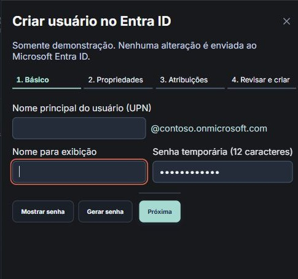
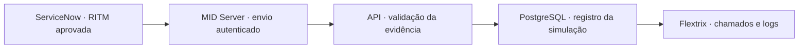

# Flextrix Identity & Access

[Read in English](README.en.md)

**Projeto de portfólio desenvolvido por Gabriel Grans.**

Aplicação web bilíngue de operações de acesso. Reúne a consulta de identidades e grupos do Microsoft Entra ID, chamados aprovados no ServiceNow e registros operacionais em uma interface com a identidade visual da Flextrix. Este projeto tem repositório próprio e deriva do [IdentityOps Platform](https://github.com/GabrielGrans/identityops-platform).

## Telas

| Entrada Flextrix | Cadastro de usuário do Entra ID |
| --- | --- |
|  |  |

## O que o projeto demonstra

- **Acessos.** Consulte usuários, grupos e associações do snapshot do Entra ID. O cadastro demonstrativo tem quatro etapas, domínio configurável, senha temporária de 12 caracteres e revisão dos grupos selecionados.
- **Chamados.** Consulte os itens de solicitação (RITMs) do ServiceNow recebidos pela aplicação e os detalhes da evidência de aprovação.
- **Logs.** Acompanhe as simulações do ServiceNow e os eventos de auditoria disponíveis para o operador.
- **Configurações.** Alterne idioma e tema. Operadores autorizados podem administrar as contas locais da plataforma.

## Integração ServiceNow



No laboratório, o envio autenticado iniciado manualmente retornou **HTTP 201**. O reenvio retornou **HTTP 200** com a mesma simulação. O disparo automático após a aprovação ainda está pendente. O cadastro, o reset de senha, o recadastro de MFA e a criação de grupos na interface são demonstrações.

## Executar localmente

Pré-requisitos do ambiente usado no projeto: **Node.js 24, Python 3.12 e PostgreSQL 17**. O Compose abaixo inicia apenas o banco. Crie um arquivo `.env` na raiz a partir de [`.env.example`](.env.example), substitua os valores de exemplo da senha do banco e da chave de sessão e mantenha `SERVICENOW_SIMULATION=true` e `ENTRA_WRITE_ENABLED=false`.

Em um banco novo, execute na raiz, com seu ambiente virtual Python ativado:

```sh
docker compose up -d --wait postgres
python -m pip install -r backend/requirements.txt
python -m backend.app.scripts.migrate --bootstrap
python -m backend.app.scripts.bootstrap_admin admin@example.com
python -m uvicorn backend.app.main:app --host 127.0.0.1 --port 8001
```

Em outro terminal:

```sh
cd frontend
npm ci
npm run dev -- --host 127.0.0.1 --strictPort
```

Abra [a interface local](http://127.0.0.1:5174/). Para personalizar o domínio do UPN demonstrativo, defina `VITE_ENTRA_UPN_DOMAIN` em `frontend/.env.local` antes de iniciar ou compilar o frontend. O domínio padrão é `contoso.onmicrosoft.com`.

O acesso a um snapshot real do Entra ID ou a chamados de uma PDI requer a configuração da respectiva integração. [Microsoft Entra ID](docs/ENTRA_ID.md) · [ServiceNow, contrato e MID Server](docs/SERVICENOW.md) · [Homologação na PDI](docs/SERVICENOW_PDI.md)

## Licença

[MIT](LICENSE). ServiceNow e Microsoft Entra ID identificam os sistemas integrados. Flextrix é um projeto de portfólio independente.
